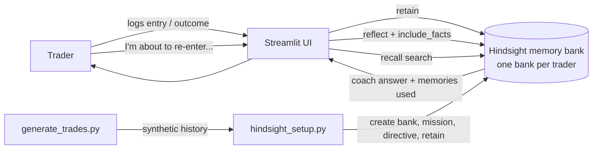

# Trading Journal Agent

A pre-trade coach that remembers **your own** trading behaviour.

Before you place a trade, you tell the agent what you are about to do and why. It looks back through your trade history, finds the patterns that have cost you money before (revenge re-entries, FOMO entries, Friday-afternoon overtrading), and tells you when you are about to repeat one. It cites the specific past trades it is relying on.

It is a **behaviour journal, not financial advice**. It never recommends instruments or predicts prices.

> All trade data in this repository is **synthetic**. Prices, tickers and P&L are made up.

## Why memory is the whole point

A generic chatbot can say "avoid emotional trading". It cannot say "this is the 7th time you re-entered within 30 minutes of a stop-loss, and 6 of those lost". That sentence only exists if the agent remembers your history, so without persistent memory the product has nothing to offer.

The UI has a **Memory ON/OFF toggle** and a **side-by-side compare** view that runs the same question against an empty memory bank and against a bank loaded with the trader's history, so the difference is visible immediately.

## How it works



1. **Log:** each trade is written as a short journal entry (instrument, quantity, the reason given, mood, whether a stop-loss was used, how long since the previous trade closed and how it ended). It is stored with `retain`.
2. **Outcome:** when the trade closes, the same entry is retained again with the outcome added. Reusing the same `document_id` replaces the old version, so nothing is duplicated.
3. **Check:** before a new trade, the plan goes to `reflect`. Hindsight retrieves the relevant memories and produces an answer shaped by the bank's mission and disposition. The UI shows the memories that were used.

## How Hindsight is used

| Hindsight feature | Where | Why |
|---|---|---|
| `create_bank`, one bank per trader | `hindsight_setup.py` | Each trader's history is isolated. The empty `trader-empty` bank powers the "memory OFF" comparison. |
| `retain` with `context`, real `timestamp`, and `document_id` | `hindsight_setup.py load`, `app.py` | Context steers fact extraction, timestamps let the agent reason about timing ("30 minutes after a loss"), and `document_id` upserts an entry when its outcome is added. |
| `reflect` with `include_facts=True` | `app.py`, `hindsight_setup.py check` | Produces the coach answer and returns the memories it was based on, which the UI displays as evidence. |
| `recall` | "What it remembers" tab | Lets anyone search what is actually stored, which makes the memory visible and debuggable. |
| `reflect_mission` and disposition (skepticism 4, empathy 2) | `hindsight_setup.py setup` | Makes the agent push back on impulsive plans instead of agreeing with the trader. |
| Directive | `hindsight_setup.py setup` | A hard rule: never recommend instruments or predict prices. |

**What the agent is not given:** the synthetic dataset has hidden pattern labels (`revenge`, `fomo`, ...). They exist only in `data/trades_ground_truth.csv` for evaluation. The text stored in Hindsight contains no labels, so the patterns have to be discovered from behaviour, notes, moods and timing.

## Project layout

```
generate_trades.py      creates the synthetic trade history and ground-truth files
hindsight_setup.py      bank setup, bulk load, command-line pre-trade check, live demo logging
app.py                  Streamlit UI
data/
  history.json          trades loaded into the bank
  demo_trades.json      held-out trades for the live demo
  trades_ground_truth.csv   every trade with its hidden pattern label (evaluation only)
  summary.txt           win rate and P&L by pattern
```

## Run it

Requirements: Python 3.10+, a Hindsight instance (Hindsight Cloud, or self-hosted with Docker) and its LLM configured.

```bash
pip install -r requirements.txt
cp .env.example .env   # then export the variables, or set them in your shell

# 1. (optional) regenerate the data; the repo already includes it
python generate_trades.py

# 2. create the banks
python hindsight_setup.py setup                       # trader-ravi: mission, disposition, directive
python hindsight_setup.py setup --bank trader-empty   # the "memory OFF" bank, left empty

# 3. load the history (memory extraction takes a few minutes)
python hindsight_setup.py load

# 4. try it from the command line
python hindsight_setup.py check "I just got stopped out, I want to re-enter right away"
python hindsight_setup.py check "I just got stopped out, I want to re-enter right away" --bank trader-empty

# 5. start the UI
streamlit run app.py
```

## The synthetic data

`generate_trades.py` builds 117 trades for one trader ("Ravi") over six weeks, with four behaviours planted on purpose (default seed 11):

| Pattern | Trades | Win rate | Net P&L (rupees, synthetic) |
|---|---|---|---|
| Planned setups with a stop-loss | 62 | 63% | +69,980 |
| Revenge re-entries | 26 | 12% | -58,070 |
| FOMO entries | 14 | 7% | -21,050 |
| Friday-afternoon overtrading | 15 | 13% | -19,410 |

The last 10 trades are held back so new trades can be logged live during a demo.

## Demo flow

1. Ask the compare view: "I just got stopped out, I want to re-enter right away with double the quantity." The empty bank gives generic advice.
2. The loaded bank answers from the trader's own history and lists the past trades it used.
3. Retain one of the held-out trades from the "Log a trade" tab and ask again to show the agent picking up the new memory.

## Results

TODO (team): after running real checks, add what you actually observed here, for example how many of the held-out impulsive trades the agent flagged. Report measured numbers only, and label them as measured on synthetic data.

## Limitations

- The data is synthetic and covers one trader. Real traders are messier.
- Answers depend on the LLM behind Hindsight and can vary between runs.
- Memory extraction is not instant, so newly logged trades may take a moment to appear in recall.
- No live market data, no brokerage integration and no financial advice.
- The evaluation view uses hidden labels, so it measures the synthetic setup, not real-world performance.

## Built with

- [Hindsight](https://github.com/vectorize-io/hindsight) for agent memory ([docs](https://hindsight.vectorize.io/))
- Streamlit and pandas for the UI

## Team

TODO (team): add names and roles.
